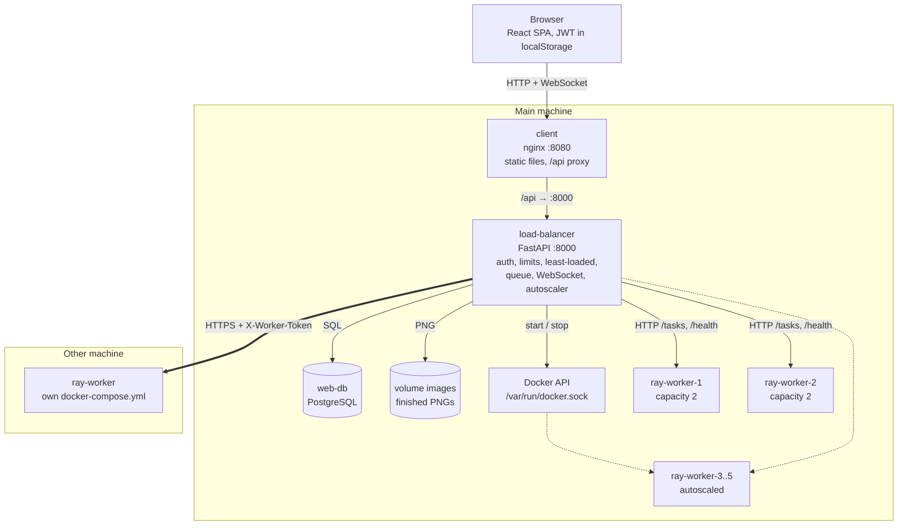

# web-raytracer

A **distributed ray tracing web service** with a custom load balancer.

Users log in, choose a 3D scene and quality, and get a rendered image. Rendering is CPU-heavy, so tasks are distributed across several C# worker servers by a self-written **least-loaded** load balancer. Users watch progress live, can cancel tasks, and browse their history. Workers can run next to the load balancer, be started by its autoscaler, or run on other machines.

This is the main repository. It ties the services together as **git submodules** and holds the shared `docker-compose.yml`.

---

## Services

| Folder | Repository | Tech | Port | Role |
|---|---|---|---|---|
| `client/` | [web-client](https://github.com/SYlence23/web-client) | React, TypeScript, Vite, TanStack Query, Tailwind, nginx | 8080 | UI: render form, live progress, history, admin panel. nginx serves the build and proxies `/api` to the load balancer |
| `load-balancer/` | [web-load-balancer](https://github.com/SYlence23/web-load-balancer) | Python, FastAPI, SQLAlchemy, httpx, Docker SDK | 8000 | Gateway: auth, limits, least-loaded balancing, queue, health checks, WebSocket progress, autoscaling, admin API |
| `ray-worker/` | [web-ray-worker](https://github.com/SYlence23/web-ray-worker) | C#, ASP.NET Core, .NET 10 | 8080 | Renders images on all CPU cores, reports progress, cancels on request. Stateless |
| — | `postgres:16` image | PostgreSQL | 5432 | `web-db`: users and task history |

Each service has its own README with details.

## Architecture



The browser only ever talks to nginx on one address. The load balancer is the only service that reaches the database and the workers. Workers keep nothing on disk: the load balancer downloads every finished image into its own volume.

### Request flow

1. **Log in.** `POST /auth/login` returns a JWT. The client keeps it in `localStorage` and sends it as `Authorization: Bearer` on every request.
2. **New render.** The form checks the limits right away, then calls `POST /renders`. The load balancer checks them again and counts the user's active tasks (at most 3).
3. **Pick a worker.** Among workers that are up and have a free slot, the one with the lowest `running / capacity` gets the task through `POST /tasks`. If every worker is full, the task gets the `queued` status, a queue position and an ETA.
4. **Render.** The worker renders rows in parallel on all CPU cores and keeps a partial image. After every row it checks for cancellation and the 300 s time limit.
5. **Live progress.** A background tracker in the load balancer polls the worker and writes progress to the database. The browser gets it over `WS /ws/renders/{id}?token=` and falls back to HTTP polling if the socket drops.
6. **Result.** When the task is `done`, the load balancer saves the final PNG to the `images` volume. The browser fetches it with the token as a blob, shows it and offers a download.
7. **Free slot.** The dispatcher sends the oldest queued task to the worker that just freed up. The autoscaler adds a worker while tasks are queued and removes idle ones after 60 s.

### Scaling and reliability

| Mechanism | How it works |
|---|---|
| Least-loaded balancing | Tasks differ in cost, so no round robin. The worker with the lowest `running / capacity` wins; a task counts as soon as it is sent, before the next health check |
| Health checks | Every 2 s the load balancer calls `GET /health` on all workers in parallel. After 3 failures in a row a worker is marked down and its active tasks fail |
| Queue and ETA | FIFO queue in PostgreSQL, so it survives a restart. ETA = `ceil(position / total capacity) × average render time` |
| Autoscaling | Through the Docker API the load balancer starts worker containers while tasks are queued or load is ≥ 80 %, and stops idle ones, within `AUTOSCALE_MIN` and `AUTOSCALE_MAX` |
| Workers on other machines | The load balancer knows workers only by URL from `RENDERERS`, so a worker can run anywhere it can reach. A shared `WORKER_TOKEN` keeps others from sending it tasks |

### Limits

| Limit | Value | Checked by |
|---|---|---|
| Resolution | 1920 × 1080 | client, load balancer (`422`), worker (`400`) |
| Samples per pixel | 256 | client, load balancer, worker |
| Complexity | width × height × spp ≤ 150,000,000 | client (meter), load balancer, worker |
| Render time | 300 s | worker cancels the task, it becomes `failed` |
| Active tasks | 3 per user | client disables the button, load balancer (`429`) |
| History | 50 per user | load balancer deletes the oldest finished tasks |
| Worker capacity | `Worker__Capacity`, 2 by default | worker answers `503`, the load balancer tries another worker or queues the task |

---

## Assignment requirements

| # | Requirement | How it is met |
|---|---|---|
| 1 | Limit task complexity | Max resolution, samples per pixel, `pixels × spp` and render time. Checked in the client and enforced in the load balancer and workers |
| 2 | Show progress | Percentage of rendered rows plus a live partial image, sent over WebSocket |
| 3 | History, status, cancel, new task, limited count, DB storage | History page, task view, cancel button, at most 3 active tasks per user, PostgreSQL |
| 4 | Authorization (HTTPS bonus) | JWT login. HTTPS is in the backlog |
| 5 | **Load balancing over ≥ 2 servers** | Self-written least-loaded balancer in FastAPI with health checks, over 2+ C# workers, which can also run on other machines |
| 6 | *Bonus:* queue and wait estimate | FIFO queue, ETA from the average render time |
| 7 | *Bonus:* horizontal autoscaling | Load balancer starts and stops worker containers through the Docker API, within min/max bounds |
| 8 | *Bonus:* admin panel | Workers, their load and status, plus all running and queued tasks |

---

## Getting started

### Requirements

- Git
- Docker Desktop (or Docker Engine + Compose)
- For local development without Docker: .NET 10 SDK, Python 3.14, Node 24

### Clone

```bash
git clone --recurse-submodules https://github.com/SYlence23/web-raytracer
cd web-raytracer
```

If you already cloned without submodules:

```bash
git submodule update --init --recursive
```

### Run everything

```bash
cp .env.example .env      # set DB_PASSWORD, JWT_SECRET, WORKER_TOKEN
docker compose up --build
```

| URL | What |
|---|---|
| http://localhost:8080 | App (client served by nginx, which proxies `/api` to the load balancer) |
| http://localhost:8000 | Load balancer API directly |
| http://localhost:8000/docs | Load balancer API docs |

Two workers always run. The load balancer starts more containers (`ray-worker-3`, `ray-worker-4`, ...) when tasks queue up and stops them once they are idle, between `AUTOSCALE_MIN` and `AUTOSCALE_MAX` from `.env` (2 and 5 by default). For that it gets the Docker socket mounted in `docker-compose.yml`.

To make a user an admin, register them on the site, then run the command below and log in again (the admin flag is part of the token):

```bash
docker compose exec load-balancer python -m app.make_admin <username>
```

Stop everything with `docker compose down`. Data stays in the `db-data` and `images` volumes; `docker compose down -v` deletes it too.

### Configuration

All settings live in `.env` next to `docker-compose.yml`. Compose passes them to the services; the services never read this file themselves.

| Variable | Default | Used by | Meaning |
|---|---|---|---|
| `DB_PASSWORD` | *(required)* | web-db, load-balancer | Database password |
| `JWT_SECRET` | *(required)* | load-balancer | Key that signs login tokens |
| `WORKER_TOKEN` | empty | load-balancer, workers | Shared secret in the `X-Worker-Token` header. Empty means no check |
| `RENDERERS` | `http://ray-worker-1:8080,http://ray-worker-2:8080` | load-balancer | Workers the load balancer always uses, comma separated |
| `AUTOSCALE_MIN` / `AUTOSCALE_MAX` | `2` / `5` | load-balancer | Bounds for the total number of workers |

### Workers on other machines

The load balancer only talks to workers over HTTP, so a worker can run on any machine it can reach.

**On the worker machine** (Docker installed), only the worker repo is needed. It has its own `docker-compose.yml`:

```bash
git clone https://github.com/SYlence23/web-ray-worker
cd web-ray-worker
docker compose up --build -d
```

This starts one worker and publishes its port 8080. Its name, port, capacity and token are set in a `.env` file there (see the worker README). Put the same `WORKER_TOKEN` there as in this repo's `.env`: the load balancer sends it in the `X-Worker-Token` header, and a worker with a token rejects every request without it. That matters as soon as the worker is reachable from outside, for example through ngrok (`ngrok http 8080`). Check it from the main machine with `curl -H "X-Worker-Token: <token>" http://<worker-ip>:8080/health`. On Windows, allow inbound TCP 8080 in the firewall if the request times out.

**On the main machine**, list it in this repo's `.env` next to the local workers and restart the load balancer:

```bash
RENDERERS=http://ray-worker-1:8080,http://ray-worker-2:8080,http://<worker-ip>:8080
docker compose up -d load-balancer
```

With ngrok, use the `https://...ngrok-free.app` address instead of `http://<worker-ip>:8080`. The remote worker shows up in the admin panel and gets tasks like any other worker. The autoscaler never stops it, because it only manages containers it started itself, but it does count toward `AUTOSCALE_MAX`.

---

## Working with submodules

- **Changing a service:** go into its folder, check out `main` (`git checkout main`), then commit and push there as usual. That updates the service's own repository.
- **Recording new versions in this repo:** at a milestone, run:
  ```bash
  git submodule update --remote
  git add client load-balancer ray-worker
  git commit -m "Update services"
  git push
  ```
- **Changing shared files** (`docker-compose.yml`, this README): commit them in this repo.

## Repository structure

```
web-raytracer/
├── client/              → submodule: web-client
├── load-balancer/       → submodule: web-load-balancer
├── ray-worker/          → submodule: web-ray-worker
├── docker-compose.yml   # web-db, load-balancer, 2 workers, client
├── .env.example
├── .gitmodules
└── README.md
```

## Known limitations

- The load balancer is a **single point of failure**. The worker registry and the dispatch lock live in its memory, so it cannot run as several copies. If it stops, the system is unavailable even though workers keep running.
- The autoscaler only starts workers on the machine where the load balancer runs. Workers on other machines are added by hand through `RENDERERS`, and a change needs a load balancer restart.
- A free ngrok address changes on every tunnel restart, so `RENDERERS` has to be updated.
- HTTPS is not enabled yet (backlog).

## Roadmap

- [x] Ray tracer renders a PNG from the console
- [x] Worker API with progress and cancel, running in Docker (2 instances)
- [x] Load balancer: health checks, least-loaded dispatch, history in web-db
- [x] docker-compose brings up the whole system
- [x] React client: render form, live progress, history
- [x] JWT auth
- [x] Queue with wait estimate
- [x] Autoscaling
- [x] Admin panel
- [x] Workers on other machines, protected by a shared token
- [ ] *Backlog:* autoscaling across several machines
- [ ] *Backlog:* HTTPS
